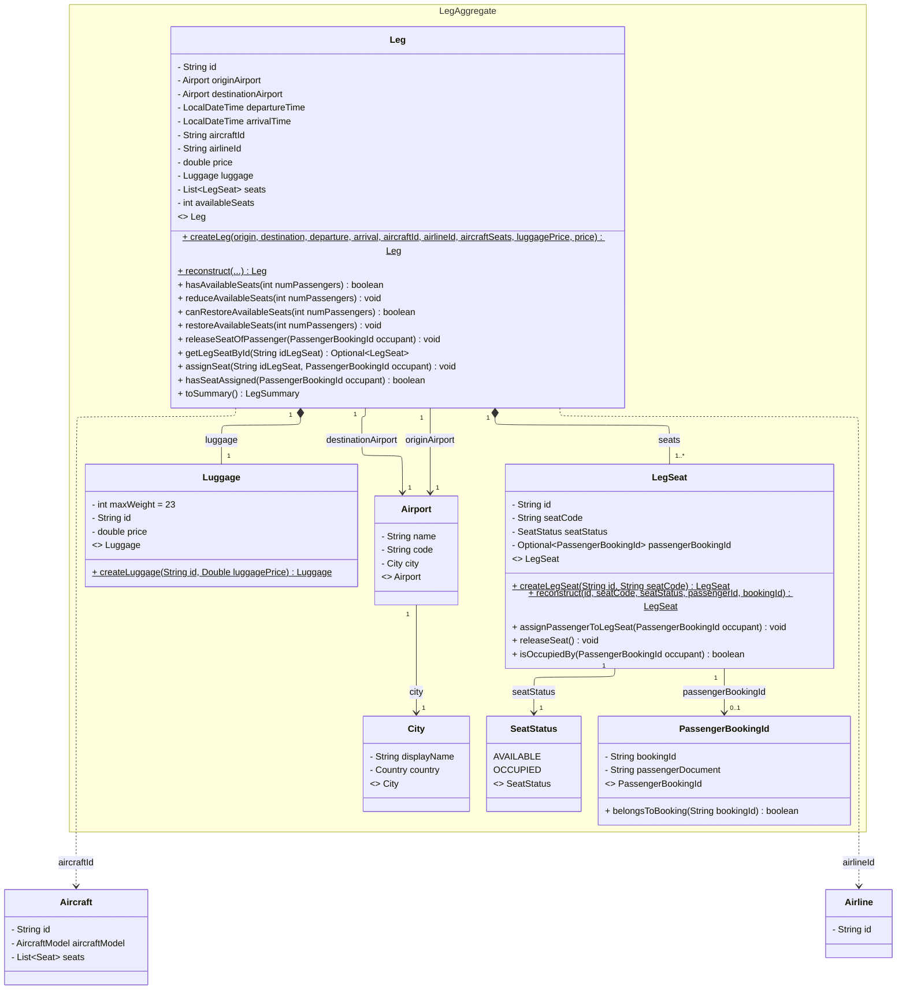

`LegSeat.passengerBookingId` holds who took the seat: the booking id and the passenger's document. The document alone is not enough, because the same person can be in two bookings on the same leg. An `OCCUPIED` seat with no `passengerBookingId` is blocked (the seed seats in `data.sql`). `availableSeats` is reduced when a flight is selected, before any `LegSeat` is assigned.
